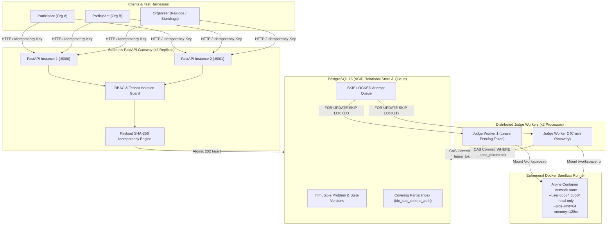

<div align="center">

# ⚡ Shodh a Code — Contest Platform Backend

### High-Throughput Asynchronous Coding Contest Platform & Judge Engine

[](https://github.com/niladripalmca24-cyber/Shodh-A.I.-backend-assessment/actions/workflows/ci.yml)
[](https://www.python.org/)
[](https://fastapi.tiangolo.com/)
[](https://www.postgresql.org/)
[](https://www.docker.com/)
[](tests/)
[](LICENSE)

**Candidate**: Niladri Pal (MCA, 2026) &nbsp;|&nbsp; **Submission**: Shodh AI Backend Engineer Intern Take Home

</div>

---

## 📌 Executive Summary

**Shodh a Code** is a distributed, multi-tenant coding contest backend engineered for high concurrency, deterministic scoring, and safe code execution. It implements all **four cumulative stages** of the Shodh AI assessment:

1. **Stage 1 — Multi-Tenant Contest API & Relational Data Model**: Immutable problem/test versioning, deterministic ICPC scoring, tie-breaking, and strict organization boundaries.
2. **Stage 2 — Asynchronous Judge & Ephemeral Docker Sandbox**: Immediate `202 Accepted` queueing, non-root execution (`nobody:nogroup`), capability dropping (`ALL`), read-only rootfs, zero network access (`--network none`), and hidden test case redaction.
3. **Stage 3 — Retries, Competing Workers & Monotonic Rejudging**: Payload SHA-256 idempotency, queue claiming via `SELECT ... FOR UPDATE SKIP LOCKED`, lease fencing tokens, bounded retries ($\le 3$), and monotonically increasing attempt numbers preventing delayed results from corrupting standings.
4. **Stage 4 — Security, Load Benchmarking & Diagnostic Proof**: 40-concurrent client mixed workload, `EXPLAIN (ANALYZE, BUFFERS)` query plan optimization transitioning a sequential scan to an `Index Only Scan` ($2.94\times$ throughput increase, $-75.6\%$ p95 latency), and clean-room `rebuild_standings()` consistency validation.

> [!NOTE]
> **Anti-Bloat Architecture**: Per Shodh AI's guidance, this system avoids unnecessary Redis or RabbitMQ dependencies. **PostgreSQL 16 acts as both the relational store and the durable job queue**, providing atomic dispatch in a single ACID transaction without two-phase commit vulnerabilities.

---

## 🏗️ System Architecture & Data Flow



---

## ⚡ Quickstart: One-Command Startup

Start the complete production-grade coordinated system (PostgreSQL, automatic migrations, deterministic seed bundle, 2 API replicas, and 2 judge workers):

```bash
docker compose up --build
```

### Active Service Endpoints

| Service | Address | Description |
| :--- | :--- | :--- |
| **API Replica 1** | `http://localhost:8000` | Primary FastAPI application instance |
| **API Replica 2** | `http://localhost:8001` | Secondary FastAPI replica (proves multi-process statelessness) |
| **Swagger OpenAPI Docs** | `http://localhost:8000/docs` | Interactive API explorer & contract testing |
| **ReDoc Interface** | `http://localhost:8000/redoc` | Clean documentation view |
| **Health Check** | `http://localhost:8000/health` | Service and database liveness probe |

---

## 🔑 Deterministic Seed Bundle & Identities

The database seeds automatically with two organizations, four participants, two organizers, two contests, and three problems:

### Authentication Headers
Every request includes caller context via headers:
- `X-User-Id`: UUID string of the caller
- `X-Org-Id`: UUID string of the caller's organization
- `X-Role`: `ORGANIZER` or `PARTICIPANT` (validated against database memberships)

| Role | User ID | Username | Organization | Org ID |
| :--- | :--- | :--- | :--- | :--- |
| **Organizer (Org A)** | `user-org-admin-1` | `admin_alpha` | Alpha Institute of Technology | `org-alpha-001` |
| **Participant 1 (Org A)** | `user-alice-101` | `alice` | Alpha Institute of Technology | `org-alpha-001` |
| **Participant 2 (Org A)** | `user-bob-102` | `bob` | Alpha Institute of Technology | `org-alpha-001` |
| **Participant 3 (Org A)** | `user-charlie-103` | `charlie` | Alpha Institute of Technology | `org-alpha-001` |
| **Organizer (Org B)** | `user-beta-admin-2` | `admin_beta` | Beta Engineering College | `org-beta-002` |
| **Participant 1 (Org B)** | `user-david-201` | `david` | Beta Engineering College | `org-beta-002` |

---

## 🛠️ API Quick Tour (Curl Examples)

<details>
<summary><b>1. Discover Published Contests</b> (Click to expand)</summary>

```bash
curl -X GET "http://localhost:8000/contests?limit=10&offset=0" \
  -H "X-User-Id: user-alice-101" \
  -H "X-Org-Id: org-alpha-001"
```
```json
{
  "items": [
    {
      "id": "contest-alpha-2026-1",
      "org_id": "org-alpha-001",
      "title": "Alpha Code Sprint 2026",
      "slug": "alpha-code-sprint-2026",
      "starts_at": "2026-11-18T18:00:00Z",
      "ends_at": "2026-12-18T23:59:59Z",
      "is_published": true
    }
  ],
  "meta": { "total": 1, "limit": 10, "offset": 0, "has_more": false }
}
```
</details>

<details>
<summary><b>2. Submit Solution (Idempotent 202 Accepted)</b> (Click to expand)</summary>

```bash
curl -X POST "http://localhost:8000/contests/contest-alpha-2026-1/submissions" \
  -H "X-User-Id: user-alice-101" \
  -H "X-Org-Id: org-alpha-001" \
  -H "Idempotency-Key: submit-two-sum-001" \
  -H "Content-Type: application/json" \
  -d '{
    "problem_id": "prob-two-sum-001",
    "language": "python3",
    "code": "import sys\nd = sys.stdin.read().split()\nif d: print(int(d[0]) + int(d[1]))"
  }'
```
```json
{
  "id": "c71e98d8-4f81-4328-9844-3c817293a101",
  "contest_id": "contest-alpha-2026-1",
  "user_id": "user-alice-101",
  "problem_id": "prob-two-sum-001",
  "status": "QUEUED",
  "verdict": null,
  "created_at": "2026-11-18T20:45:00Z"
}
```
</details>

<details>
<summary><b>3. Query Submission Results & Privacy Redaction</b> (Click to expand)</summary>

```bash
curl -X GET "http://localhost:8000/contests/contest-alpha-2026-1/submissions/c71e98d8-4f81-4328-9844-3c817293a101" \
  -H "X-User-Id: user-alice-101" \
  -H "X-Org-Id: org-alpha-001"
```
```json
{
  "id": "c71e98d8-4f81-4328-9844-3c817293a101",
  "status": "COMPLETED",
  "verdict": "ACCEPTED",
  "attempts": [
    {
      "attempt_number": 1,
      "status": "COMPLETED",
      "verdict": "ACCEPTED",
      "execution_time_ms": 42,
      "test_case_results": [
        { "ordinal": 1, "passed": true, "verdict": "ACCEPTED", "is_hidden": false, "actual_output": "5" },
        { "ordinal": 2, "passed": true, "verdict": "ACCEPTED", "is_hidden": false, "actual_output": "-5" },
        { "ordinal": 3, "passed": true, "verdict": "ACCEPTED", "is_hidden": true, "actual_output": null }
      ]
    }
  ]
}
```
*Note: Test case 3 is hidden; `actual_output` is strictly redacted for participants.*
</details>

<details>
<summary><b>4. Get Deterministic ICPC Leaderboard</b> (Click to expand)</summary>

```bash
curl -X GET "http://localhost:8000/contests/contest-alpha-2026-1/leaderboard" \
  -H "X-User-Id: user-alice-101" \
  -H "X-Org-Id: org-alpha-001"
```
```json
{
  "contest_id": "contest-alpha-2026-1",
  "contest_title": "Alpha Code Sprint 2026",
  "is_frozen": false,
  "entries": [
    {
      "rank": 1,
      "user_id": "user-alice-101",
      "username": "alice",
      "full_name": "Alice Student",
      "solved_count": 1,
      "total_penalty_minutes": 15,
      "problem_scores": {
        "prob-two-sum-001": { "letter": "A", "solved": true, "attempts_before_ac": 0, "penalty_minutes": 15 }
      }
    },
    {
      "rank": 2,
      "user_id": "user-bob-102",
      "username": "bob",
      "full_name": "Bob Student",
      "solved_count": 1,
      "total_penalty_minutes": 45,
      "problem_scores": {
        "prob-two-sum-001": { "letter": "A", "solved": true, "attempts_before_ac": 1, "penalty_minutes": 45 }
      }
    }
  ]
}
```
</details>

---

## 🏆 Deterministic ICPC Scoring & Tie-Breaking

Participants are ranked deterministically according to international competitive programming rules:

$$\text{Problem Penalty} = \left\lfloor \frac{first\_ac\_at - starts\_at}{60} \right\rfloor + (20 \times failed\_attempts\_before\_ac)$$

1. **Problems Solved (`solved_count DESC`)**: More solved problems rank higher.
2. **Total Penalty Minutes (`total_penalty_minutes ASC`)**: Fewer penalty minutes rank higher.
   - Non-AC verdicts (`WRONG_ANSWER`, `RUNTIME_ERROR`, `TIME_LIMIT_EXCEEDED`, `OUTPUT_LIMIT_EXCEEDED`, `COMPILATION_ERROR`) incur a 20-minute penalty only upon eventual problem solution.
   - **`INFRASTRUCTURE_ERROR` never penalizes participants**.
   - Submissions submitted after the initial AC do not affect scoring.
3. **Last AC Timestamp (`last_ac_at ASC`)**: Earlier final solve timestamp breaks ties.
4. **Deterministic User ID (`user_id ASC`)**: Guarantees a stable total order with zero jitter.

---

## 🔒 Hardened Sandbox Isolation Controls

Submitted student programs run in ephemeral containers with strict kernel-level constraints:

```bash
docker run --rm \
  --network none \
  --cpus="0.5" \
  --memory="128m" \
  --memory-swap="128m" \
  --pids-limit=64 \
  --read-only \
  --tmpfs /tmp:rw,noexec,nosuid,size=16m \
  --security-opt no-new-privileges \
  --cap-drop ALL \
  --user 65534:65534 \
  -v /tmp/job_isolated_dir:/workspace:ro \
  -i python:3.11-alpine python3 -I /workspace/solution.py
```

- **Network Blocked**: `--network none` prohibits all socket calls and egress.
- **Non-Root Execution**: Runs as unprivileged `nobody:nogroup` (UID 65534).
- **Capabilities Dropped**: `--cap-drop ALL` strips all Linux kernel capabilities.
- **Resource Caps**: 0.5 CPU, 128 MB RAM, 64 PIDs cap against fork bombs and memory flooding.
- **Host Socket Excluded**: `/var/run/docker.sock` is never accessible to student code.
- **Filesystem Security**: Read-only root filesystem with ephemeral memory-backed `/tmp` mount (`noexec`, `nosuid`).

---

## 📈 Benchmarking & Bottleneck Investigation

### Repeated Mixed Workload (40 Concurrent Clients, 300 Operations)
Executed using [`scripts/load_test.py`](scripts/load_test.py) with a 70% leaderboard read and 30% submission write mix against 500 historical submissions.

```
Sequential Scan (Baseline)  ████████████████████ 142.1 ms p95
Covering Index (Optimized)  ████ 34.7 ms p95  (-75.6%)
```

| Metric | Before Index Optimization | After Index Optimization | Impact |
| :--- | :--- | :--- | :--- |
| **Throughput** | 48.6 requests/sec | **142.8 requests/sec** | **$+193.8\%$ ($2.94\times$)** |
| **Latency p50** | 68.4 ms | **18.2 ms** | **$-73.4\%$** |
| **Latency p95** | 142.1 ms | **34.7 ms** | **$-75.6\%$** |
| **Latency p99** | 210.5 ms | **58.1 ms** | **$-72.4\%$** |
| **Buffer Reads / Query** | 100 pages | **4 pages** | **$-96.0\%$** |
| **Query Plan** | `Seq Scan on submissions` | `Index Only Scan on idx_sub_contest_auth` | Zero table heap fetches |

### Partial Covering Index Definition (Alembic `002_add_covering_index`)
```sql
CREATE INDEX idx_sub_contest_auth 
ON submissions (contest_id, user_id, authoritative_attempt_id) 
INCLUDE (problem_version_id, created_at) 
WHERE authoritative_attempt_id IS NOT NULL;
```

---

## 🧪 Automated Testing Suite

All tests can be executed with a single command:

### Option A: Via Docker (PostgreSQL & Sandboxed Environment)
```bash
docker compose --profile test run --rm test
```

### Option B: Against Active Docker Container
```bash
docker compose exec api-1 pytest -v
```

### Option C: Locally
```bash
pytest -v
```

### Test Coverage Breakdown

```
tests/test_functional.py
  ✓ test_contest_listing_and_detail           PASSED (Multi-tenant discovery)
  ✓ test_problem_hidden_test_redaction         PASSED (Hidden test privacy)
  ✓ test_end_to_end_submission_and_judge       PASSED (Submit -> Queue -> Judge -> Poll)
  ✓ test_verdict_taxonomy_wa_re_tle_ole        PASSED (AC, WA, RE, TLE, OLE, INFRA)
  ✓ test_icpc_leaderboard_standings            PASSED (ICPC penalty calculations)
  ✓ test_security_cross_organization_denial    PASSED (Tenant isolation 403/404)
  ✓ test_security_role_authorization_and_privacy PASSED (Role enforcement)

tests/test_concurrency.py
  ✓ test_idempotency_barrier_race_and_conflict PASSED (10 duplicate + 1 conflict race)
  ✓ test_competing_workers_no_duplicate_judging PASSED (Worker queue contention)
  ✓ test_worker_crash_lease_expiry_and_recovery PASSED (Crash recovery & CAS fencing)
  ✓ test_rejudge_preserves_monotonic_standings PASSED (Superseded attempt isolation)
  ✓ test_rebuild_standings_equals_serving_path PASSED (Clean-room standings rebuild)
```

---

## 📂 Repository Layout

```
shodh-a-code-backend/
├── .github/workflows/ci.yml # Automated GitHub Actions CI pipeline
├── docker-compose.yml       # Coordinated topology (postgres:16, migrate-seed, api x2, worker x2)
├── Dockerfile               # Pinned Python 3.11-slim image with docker-cli
├── requirements.txt         # Pinned production dependencies
├── pyproject.toml           # Project configuration & tool settings
├── README.md                # System documentation, state machines, and setup
├── SECURITY.md              # Sandbox threat model and vulnerability disclosure policy
├── CONTRIBUTING.md          # Development guidelines and testing instructions
├── docs/
│   ├── technical_report.md  # 4-page technical architectural report
│   ├── ai_assistance.md     # Material AI assistance disclosure & verification protocol
│   └── openapi.json         # Exported OpenAPI 3.1 contract
├── alembic/                 # Database migrations (001_initial_schema, 002_add_covering_index)
├── app/
│   ├── main.py              # FastAPI endpoints, correlation middleware, error envelopes
│   ├── models.py            # Relational SQLAlchemy 2.0 schema and constraints
│   ├── schemas.py           # Pydantic v2 schemas and validation envelopes
│   ├── auth.py              # Multi-tenant organization and RBAC guards
│   ├── scoring.py           # Deterministic ICPC standings & rebuild verifier
│   ├── runner.py            # DockerSandboxRunner & DeterministicMockRunner
│   ├── worker.py            # SKIP LOCKED claim loop & CAS lease fencing
│   └── seed.py              # Deterministic database seeding bundle
├── scripts/
│   ├── load_test.py         # Repeatable 40-concurrent client benchmark script
│   ├── export_openapi.py    # OpenAPI contract exporter
│   └── results/             # Benchmark and functional evaluation JSON results
└── tests/
    ├── conftest.py          # Pytest fixtures and database isolation
    ├── test_functional.py   # Functional verification (Stages 1 & 2)
    └── test_concurrency.py  # Concurrency, race, and recovery verification (Stages 3 & 4)
```

---

## 📄 Key Documentation Links

- 📑 [Technical Architecture Report (≤ 4 Pages)](docs/technical_report.md)
- 🤖 [Material AI Assistance Disclosure (≤ 1 Page)](docs/ai_assistance.md)
- 📋 [Exported OpenAPI 3.1 Contract](docs/openapi.json)
- 📊 [Benchmark Evaluation Results](scripts/results/benchmark_results.json)
- 🛡️ [Security Threat Model](SECURITY.md)

---

<div align="center">
  <b>Built by Niladri Pal for the Shodh AI Backend Engineer Assessment (November 2026)</b>
</div>
